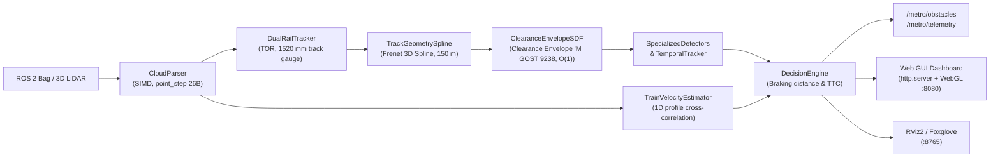
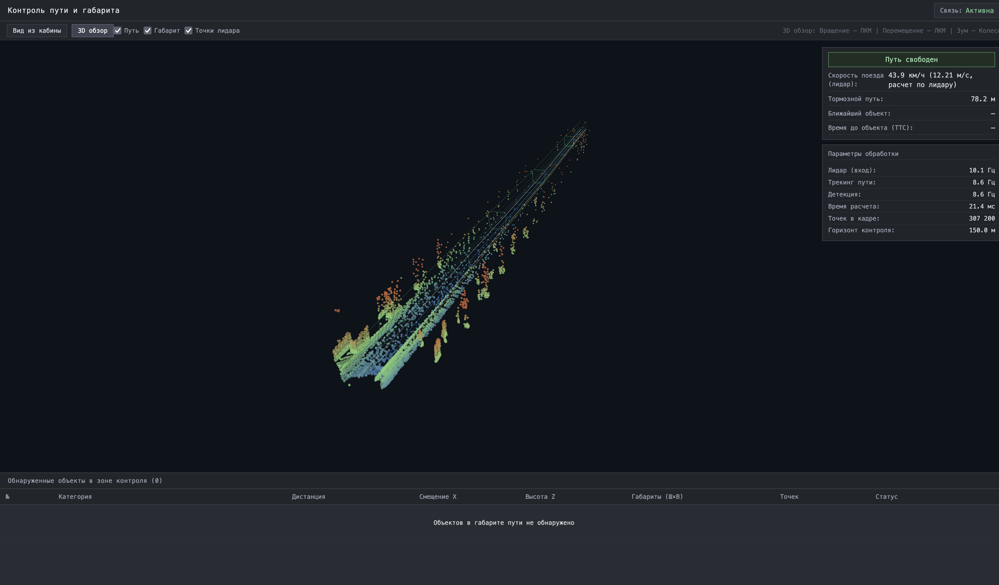
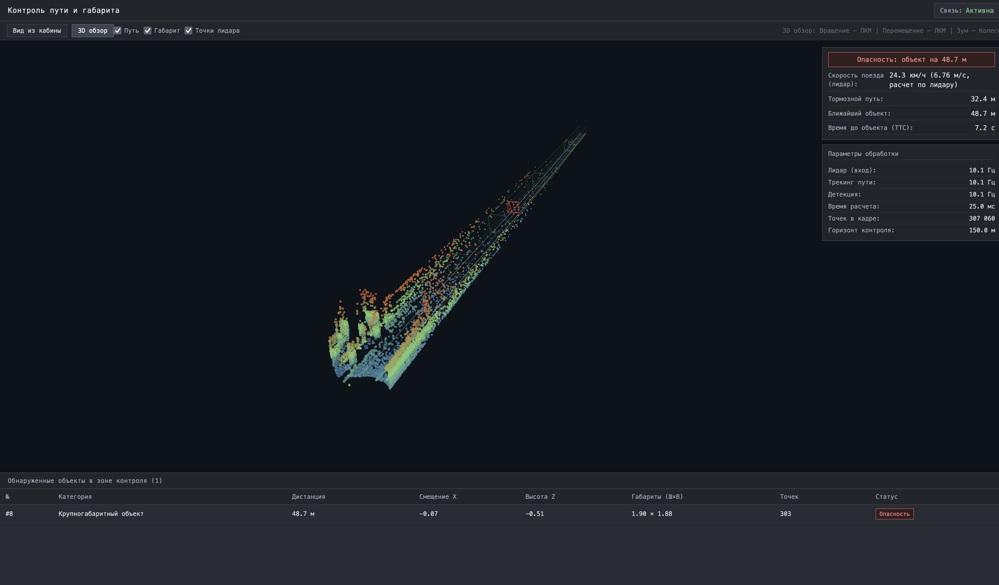
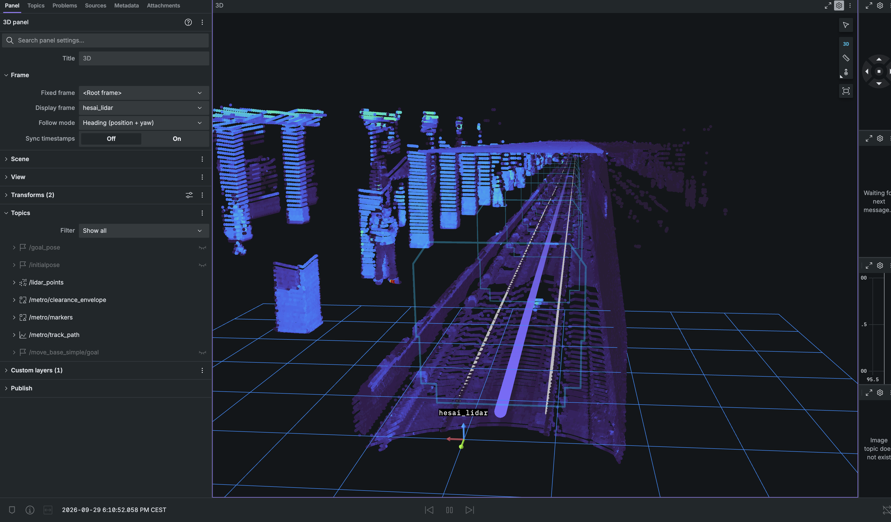
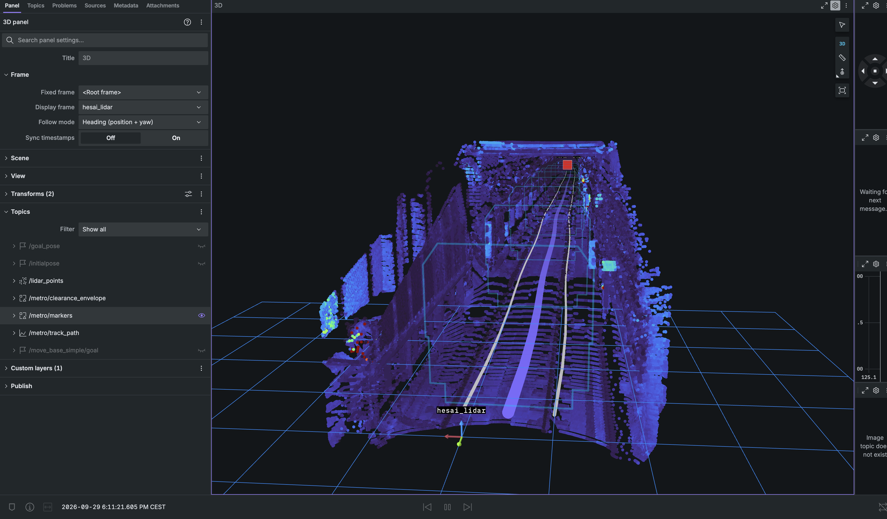

# Team: MOPSY
--- 
# Clearance Envelope Monitoring & Obstacle Detection via 3D LiDAR

Software suite for track clearance and kinematic clearance envelope monitoring for metro trains based on on-board 3D LiDAR data.

Solution developed as part of Task #5: "Foreign Object Detection System for Driverless Metro Trains in Subway Tunnels Based on 3D LiDAR Data" (Moscow Department of Transport / Moscow Metro).

> [!NOTE]
> Detailed mathematical formulation, Frenet frame derivations, and track infrastructure analysis are documented in [**`SOLUTION.md`**](SOLUTION.md). For Russian documentation, see [**`README_RU.md`**](README_RU.md).

> [!NOTE]
> **Video Demonstration:** The repository includes a full-cycle video recording of system startup and multi-scenario rosbag validation: [**`docs/MetroLidarDemo.mp4`**](docs/MetroLidarDemo.mp4) (see details in [Section 4](#4-visualization-and-operator-interface)). The video is also available at https://disk.yandex.ru/d/If8lk82Lm65f6g.

> [!NOTE]
> The repository also includes a team presentation summarizing the engineering approach. The [**`docs/`**](docs/) directory contains presentations in `PPTX` and `PDF` formats.

---

## 1. Solution Architecture and Data Flow

The suite is implemented in C++17 (core algorithmic detection engine) and Python 3 (monitoring web interface) on **ROS 2 Humble**.



### System Modules:
* **`cloud_parser`** (`C++17`): Streaming parser for `sensor_msgs/msg/PointCloud2`. Safe deserialization of unaligned binary records (point_step = 26 bytes in Hesai Pandar 128) via `std::memcpy` without alignment fault risks on ARM64 / x86_64.
* **`dual_rail_tracker`** (`C++17`): Dual rail track correlator ($1520 \pm 80$ mm) and Top of Rail (TOR) height estimator using the 90th percentile of roadbed elevation in the near field ($d \in [4, 16]$ m). Eliminates drainage ditch artifacts up to 45 cm deep.
* **`track_geometry_spline`** (`C++17`): 3D tunnel centerline trajectory synthesis up to a **150.0 m** lookahead horizon (41 waypoints with adaptive step: 2 m up to 40 m, 4 m up to 80 m, 6 m up to 150 m). Automatic classification of single-track and double-track sections by cross-sectional span ($W > 6.5$ m $\to$ double-track). Dynamic tunnel crown tracking in curves ($R \ge 160$ m) with lateral track offsets up to 14 m. EMA temporal filtering ($\alpha = 0.40$).
* **`clearance_envelope_sdf`** (`C++17`): Analytical Signed Distance Field (SDF) of the kinematic structure clearance envelope "M" (GOST 9238-2013). Point containment check complexity: $\mathcal{O}(1)$.
* **`specialized_detectors`** (`C++17`): Multi-scale candidate extraction (volumetric bodies, rail obstacles, dangling overhead cables).
* **`temporal_obstacle_tracker`** (`C++17`): Inter-frame cluster association (IoU + Euclidean distance). Obstacle confirmation over 2 frames ($N_{\text{confirm}} \ge 2$), suppressing transient sensor noise.
* **`train_velocity_estimator`** (`C++17`): Linear velocity estimation via 1D spatial cross-correlation of longitudinal tunnel profiles between consecutive LiDAR frames (does not require external odometry).
* **`decision_engine`** (`C++17`): Threat classification for each detected object (CRITICAL / WARNING / INFO), calculation of stopping distance $S_{\text{brake}}(V)$ and Time-To-Collision (TTC).
* **`metro_web_gui`** (`Python 3`): Built-in lightweight telemetry web server (port 8080) powered by standard library `http.server` with native WebGL 3D scene rendering and zero third-party dependencies.

---

## 2. Algorithm Overview

### 2.1. Clearance Violation Monitoring
Because metro tunnels remain unobstructed the vast majority of the time, and training datasets for catastrophic tunnel incidents do not exist, the system applies deterministic geometric verification: validating point penetration into the kinematic clearance envelope volume of the rolling stock.

The space along the track is parameterized in the Frenet-Serret frame $(s, u, v)$, where $s$ is the arc length along the track curve, $u$ is the lateral offset, and $v = Z - Z_{\text{rail}}$ is the height above Top of Rail (TOR).

### 2.2. Analytical Clearance Envelope "M" (GOST 9238-2013)
The envelope is approximated by a piecewise-smooth admissible half-width function $W(v)$:
* $v < 0.12$ m — ballast bed and turnout frogs exclusion;
* $v \in [0.12, 0.45]$ m — underbody equipment zone ($W = 1.05$ m, third rail isolation at $|u| \ge 1.12$ m);
* $v \in [0.45, 1.25]$ m — station platform zone ($W = 1.30$ m, clearance cutout for passenger platforms at $1.42$ m);
* $v \in [1.25, 2.45]$ m — car body belt ($W = 1.35$ m);
* $v \in [2.45, 2.80]$ m — aerodynamic roof taper ($W = 1.35 \to 1.05$ m);
* $v > 2.80$ m — tunnel crown.

The signed distance $\text{SDF}(u, v) = |u| - W(v)$ is computed in $\mathcal{O}(1)$ operations: $\text{SDF} < 0$ indicates object penetration into the clearance envelope.

### 2.3. Threat Zoning and Stopping Distance Calculation
Train stopping distance is modeled in accordance with metro operating regulations and `params.yaml` configuration, factoring in braking system reaction time ($t_{\text{react}} = 0.50$ s), normative emergency deceleration ($a_{\text{emerg}} = 1.20$ m/s²), and a guaranteed safety stop margin ($S_{\text{margin}} = 10.0$ m):
$$S_{\text{brake}}(V) = V \cdot t_{\text{react}} + \frac{V^2}{2 \cdot a_{\text{emerg}}} + S_{\text{margin}} = V \cdot 0.50 + \frac{V^2}{2.40} + 10.0$$

*Calculated reference values:*
* At $V = 43.9$ km/h ($12.21$ m/s, Web GUI screenshot): $S_{\text{brake}} = 12.21 \cdot 0.50 + \frac{12.21^2}{2.40} + 10.0 = \mathbf{78.2}\text{ m}$;
* At $V = 60.0$ km/h ($16.67$ m/s): $S_{\text{brake}} = \mathbf{134.1}\text{ m}$;
* At $V \approx 63.8$ km/h ($17.72$ m/s), braking distance reaches the maximum LiDAR lookahead limit ($150.0$ m).

Deterministic threat classification (`DecisionEngine`):
* **`CRITICAL` (Emergency braking):** confirmed object inside the envelope ($\text{SDF} \le 0.0$ m) at distance $D \le S_{\text{brake}}(V)$;
* **`WARNING` (Advisory alert):** confirmed object inside envelope at distance $D > S_{\text{brake}}(V)$ or object within the buffer clearance zone ($\text{SDF} \in (0, 0.30]$ m);
* **`INFO` (Informational tracking):** distant horizon objects or objects outside the clearance buffer.

---

## 3. Quick Start with Docker

The `run_docker.sh` script is designed to be executed from any terminal (`bash run_docker.sh`) regardless of the current working directory.

### 3.1. Building Docker Image
```bash
./run_docker.sh --build
```

### 3.2. Auto-run (first bag from `bags/` directory)
Place a rosbag in the `bags/` folder and run:
```bash
./run_docker.sh --auto
```
*The script will automatically detect the first available dataset, resolve the point cloud topic, and launch processing.*

### 3.3. Running a Specific Bag
```bash
# By folder/file name in bags/ or archive/for_hackathon/:
./run_docker.sh --bag doubleT_obstacle

# Additional examples:
./run_docker.sh --bag roundT_pressureGate_roundT
./run_docker.sh --bag squareT_platform_squareT_switch

# By arbitrary path on disk:
./run_docker.sh --bag /path/to/custom_bag
```

### 3.4. Additional Options
```bash
# Interactive bash inside the container:
./run_docker.sh --shell

# View help and detected bag files:
./run_docker.sh --help
```

---

## 4. Visualization and Operator Interface

The suite provides two independent real-time visualization interfaces: a proprietary lightweight web interface (port 8080) and integration with Foxglove Studio / RViz2 (port 8765).

### 4.1. Video Demonstration (`docs/MetroLidarDemo.mp4`)

The repository includes a video recording ([**`docs/MetroLidarDemo.mp4`**](docs/MetroLidarDemo.mp4), 4 min 07 sec) demonstrating a complete startup cycle and validation across various rosbags:
* **Deployment & Startup:** build and launch via `run_docker.sh`, automatic LiDAR topic resolution, launching the detection node and telemetry web server;
* **Testing across multiple scenarios (rosbag):**
  * `doubleT_platform`: traversing a double-track tunnel, station passage (isolating the platform from the train clearance envelope, `CLEAR TRACK` status, speed estimation);
  * `cloud_with_fake_obj`: operation with synthetic obstacles, triggering `DANGER: BRAKE` emergency state and 3D Bounding Box rendering;
  * `doubleT_obstacle`: dynamic detection of a foreign object on the running track, braking distance computation, triggering `DANGER: BRAKE` and 3D Bounding Box rendering;
* **Synchronous Visualization:** concurrent execution of Web GUI Dashboard (`http://localhost:8080`) and Foxglove Studio 3D panel (`ws://localhost:8765`).

Team solution presentation: [**`docs/ЛЦТ_МОПСЫ_презентация.pdf`**](docs/ЛЦТ_МОПСЫ_презентация.pdf) ([source .pptx](docs/ЛЦТ_МОПСЫ_презентация.pptx)).

### 4.2. Web GUI Dashboard (`http://localhost:8080`)
The web interface requires no external software installation, runs in any modern browser, and is optimized for train operational monitoring:
* **CAD Palette & HUD:** track status (`CLEAR TRACK` / `DANGER: OBSTACLE AT ... M`), train speed, braking distance, obstacle distance, and TTC;
* **WebGL 3D Scene:** tunnel point cloud, rails (1520 mm track gauge), GOST 9238 "M" clearance envelope wireframe, and 3D bounding boxes of detected obstacles;
* **Real-time Telemetry:** LiDAR rate (10.1 Hz), processing throughput (8.6–10.1 Hz), frame compute latency ($21.4 \dots 25.0$ ms on 307,000 points).


*Figure 1. Web GUI Dashboard: clear track mode (speed 43.9 km/h, braking distance 78.2 m, compute time 21.4 ms on 307,200 points).*


*Figure 2. Web GUI Dashboard: obstacle #8 detected at distance 48.7 m (dimensions 1.90×1.88 m, status "Danger", TTC 7.2 s, compute time 25.0 ms).*

### 4.3. Foxglove Studio / RViz2
Connection via Foxglove WebSocket protocol (`ws://localhost:8765`) or native RViz2:


*Figure 3. Foxglove Studio: kinematic clearance envelope "M" wireframe (cyan outline), rails, and track trajectory up to 150 m. Station platform and structural columns are isolated outside the envelope.*


*Figure 4. Foxglove Studio: spatial detection of an obstacle on the running track (red 3D marker on `/metro/markers`).*

---

## 5. Parameters and Configuration

Configuration is defined in `src/metro_obstacle_detector/config/params.yaml`:

| Parameter | Default | Description |
|---|---|---|
| `lookahead_distance` | `150.0` m | Maximum monitoring and spline synthesis horizon |
| `min_distance` | `2.0` m | Start of detection zone in front of sensor |
| `min_curve_radius` | `160.0` m | Minimum horizontal track curve radius |
| `gauge` | `1.520` m | Metro track gauge width |
| `nominal_tor_height` | `1.075` m | Nominal height of LiDAR mount above Top of Rail (TOR) |
| `emergency_deceleration` | `1.20` m/s² | Emergency train braking deceleration (metro regulations) |
| `system_reaction_time` | `0.50` s | Brake system and pneumatic line reaction time |
| `safety_stop_margin` | `10.0` m | Guaranteed safety distance margin at complete stop |
| `train_speed_mps` | `0.0` m/s | Initial speed (0.0 enables dynamic LiDAR estimation) |
| `lidar_topic` | `/lidar_points` | Point cloud topic name (auto-detected by runner) |
| `qos_reliability` | `sensor_data` | QoS subscription reliability profile |

---

## 6. ROS 2 Output Interfaces

| Topic | Type | Purpose |
|---|---|---|
| `/metro/obstacles` | `metro_obstacle_detector_interfaces/msg/ObstacleArray` | Array of active obstacles, threat status, emergency brake flag, TTC, braking distance |
| `/metro/track_path` | `nav_msgs/msg/Path` | 3D trajectory of track centerline up to 150 m horizon |
| `/metro/track_profile` | `metro_obstacle_detector_interfaces/msg/TrackProfile` | Estimated TOR height, running rail coordinates, tunnel profile type |
| `/metro/train_speed` | `std_msgs/msg/Float32` | Estimated linear train speed from LiDAR cross-correlation (m/s) |
| `/metro/telemetry` | `metro_obstacle_detector_interfaces/msg/SystemHealth` | Frame computation time (ms), processing rates, point counts |
| `/metro/markers` | `visualization_msgs/msg/MarkerArray` | 3D bounding boxes with threat color coding for RViz2 |
| `/metro/clearance_envelope` | `visualization_msgs/msg/MarkerArray` | 3D wireframe of GOST 9238 "M" kinematic clearance envelope |

---

## 7. Testing and Verification Results

Algorithm verification was performed across all provided datasets recorded in Moscow Metro tunnels, as well as on a suite of synthetic obstacles:

| Dataset / Scenario | Track Obstacle | Status in Working Zone ($D \le 70$ m) | False Stops (`CRITICAL`) | Distant Horizon ($135 \pm 10$ m) | Infrastructure Characteristics and Curve Physics |
|---|:---:|:---:|:---:|:---:|---|
| `doubleT_obstacle` | **YES** | **EMERGENCY BRAKE** | **0** (true positive) | `WARNING` ($76 \dots 107$ m) | Running track obstacle reliably acquired ($17.5 \dots 35.0$ m) and tracked ($N_{\text{confirm}} \ge 2$) |
| `doubleT_platform` | **NO** | **CLEAR TRACK** | **0** | **`WARNING` (50–80% frames)**, $125 \dots 145$ m | Platform ($1.42$ m) isolated by $1.30$ m cutout. In $135$ m curve, straight spline extrapolation touches tunnel wall |
| `roundT_doubleT` | **NO** | **CLEAR TRACK** | **0** | **`WARNING` (~50% frames)**, $110 \dots 145$ m | Transition to double-track bellmouth; spline extrapolation touches side crown at $135$ m horizon |
| `roundT_pressureGate_roundT` | **NO** | **WARNING** ($18.4$ m) | **0** | `INFO` / `CLEAR` | Traversal of blast gate in curve ($R \approx 200$ m); $5 \dots 10$ cm clearance margin triggers expected `WARNING` without emergency brake trip |
| `squareT_platform_squareT_switch` | **NO** | **CLEAR TRACK** | **0** | `CLEAR` | Turnout switch and platform; frogs at TOR level are excluded by ballast buffer ($v < 0.12$ m) and tracker |

### 7.1. Engineering Analysis of Distant Curve Warnings ($135 \pm 10$ m)
During real runs through curved sections of double-track tunnels (`doubleT`), recurring alerts of `WARNING` level occur at the distant horizon of $125 \dots 145$ m (approximately 1–3 clusters per frame across 50–80% of curve frames). This is a natural physical consequence of sensor geometry and algorithm kinematics:
1. **Double-track tunnel curve geometry:** In a double-track tunnel ($W > 6.5$ m), the train runs offset toward one of the outer walls. With a curve radius of $R \approx 250 \dots 400$ m, the circular arc deflection at distance $L = 135$ m is $f \approx \frac{L^2}{2R} \approx 22 \dots 36$ m, whereas the tunnel wall is situated only $2.5 \dots 3.5$ m from the track centerline;
2. **LiDAR beam divergence:** At a distance of $135$ m, the incidence angle of beams grazing the rails is below $0.45^\circ$. The sensor physically receives no usable returns from rail heads, requiring spline extrapolation along the current tangent on the distant horizon;
3. **Safety threat zoning:** The tangent-projected envelope "M" inevitably intersects the curving tunnel wall or cable racks at $135 \pm 10$ m. However, at operational speeds ($40 \dots 60$ km/h), the calculated stopping distance is $S_{\text{brake}} = 78.2 \dots 134.1$ m, which is strictly less than the detection horizon ($D \approx 135$ m). The decision module (`DecisionEngine`) classifies these distant events as **`WARNING`** (advisory alerts without emergency braking), **guaranteeing zero false emergency stops (`CRITICAL = 0`)** on curved track segments.

### 7.2. Synthetic Obstacles (`cloud_with_fake_obj`):
* Volumetric object 2×2 m: detected at **$28.3$ m** (722 points, `CRITICAL`);
* Small object 0.3×0.3 m: detected at **$17.1$ m** (71 points, `CRITICAL`);
* Foreign track tie on rails: detected at **$65.7$ m** (41 points, `CRITICAL`);
* Dangling overhead cable ($\varnothing 5$ cm): detected at **$127.2$ m** (13 points, `WARNING`);
* Object on envelope margin: detected at **$88.1$ m** (371 points, `WARNING`).

### 7.3. Processing Speed and Layer-by-Layer Latency Breakdown

Benchmark measurements conducted on a Macbook Pro M5 Pro workstation using real Hesai Pandar 128 point clouds (307,200 points per frame):

| Layer / Pipeline Stage | Compute Time | Share | Complexity | Engineering Implementation and Optimizations |
|---|:---:|:---:|:---:|---|
| **1. CloudParser** (PointCloud2 streaming parser) | $4.2 \dots 5.5$ ms | $21\%$ | $\mathcal{O}(N)$ | SIMD `std::memcpy` with 26-byte stride, `NaN` filtering, and longitudinal binning |
| **2. DualRailTracker** (rail discovery & TOR level) | $2.1 \dots 3.0$ ms | $11\%$ | $\mathcal{O}(N_{\text{bed}} \log N)$ | $1520 \pm 80$ mm gauge correlation, 90th percentile TOR, ignoring ditches deeper than 20 cm |
| **3. TrackGeometrySpline** (150 m 3D trajectory) | $2.8 \dots 3.8$ ms | $14\%$ | $\mathcal{O}(K \cdot M)$ | Frenet spline (adaptive 2/4/6 m step, 41 waypoints), dynamic crown tracking in curves ($R \ge 160$ m) |
| **4. ClearanceEnvelopeSDF** (GOST 9238 envelope "M") | $6.5 \dots 8.5$ ms | $34\%$ | $\mathcal{O}(1)$ / pt | Analytical 2D Signed Distance Field (SDF) evaluated per beam across track cross-sections |
| **5. SpecializedDetectors & Tracker** | $2.0 \dots 3.2$ ms | $12\%$ | $\mathcal{O}(N_{\text{in}} \log N)$ | Candidate clustering (volumetric bodies, rail obstacles, cables), temporal tracking ($N_{\text{conf}} \ge 2$) |
| **6. TrainVelocityEstimator & DecisionEngine** | $0.8 \dots 1.2$ ms | $5\%$ | $\mathcal{O}(B \log B)$ | 1D tunnel profile cross-correlation (velocity $V$), $S_{\text{brake}}(V)$ and TTC calculation |
| **Total Frame Processing Cycle** | **$21.4 \dots 25.0$ ms** | **$100\%$** | — | **Throughput: $40 \dots 47$ FPS** ($\times 4$ margin over 10 Hz LiDAR) |

*Actual cycle time measured in operator web interface (see Figures 1–2): **$21.4$ ms** on clear track and **$25.0$ ms** during active obstacle detection on 307,000 points.*

Detailed mathematical derivations: [**`SOLUTION.md`**](SOLUTION.md).

---

## 8. Limitations of the Method

1. **Resolution at distant horizons:** Beyond 120–150 m, LiDAR beam angular divergence reduces point density; small objects with cross-sections under $10 \times 10$ cm may be captured by only $1 \dots 3$ points;
2. **Constrained clearance portals:** In the opening of heavy blast gates on curves, clearance to the steel portal frame narrows to $5 \dots 10$ cm, triggering expected `WARNING` alerts;
3. **Dense airborne dust:** Under extreme tunnel dust conditions with suspended cement particles, multi-sensor fusion with radar or vision channels is recommended;
4. **Spatial periodicity of cast-iron tunnel lining:** In circular shield tunnels, regular spacing of cast-iron tubbings (~1 m) can introduce correlogram peak aliasing during 1D cross-correlation velocity estimation. In `TrainVelocityEstimator`, this is mitigated through median derivative filtering, historical maximum tracking, and acceleration/odometry bounds.

---
